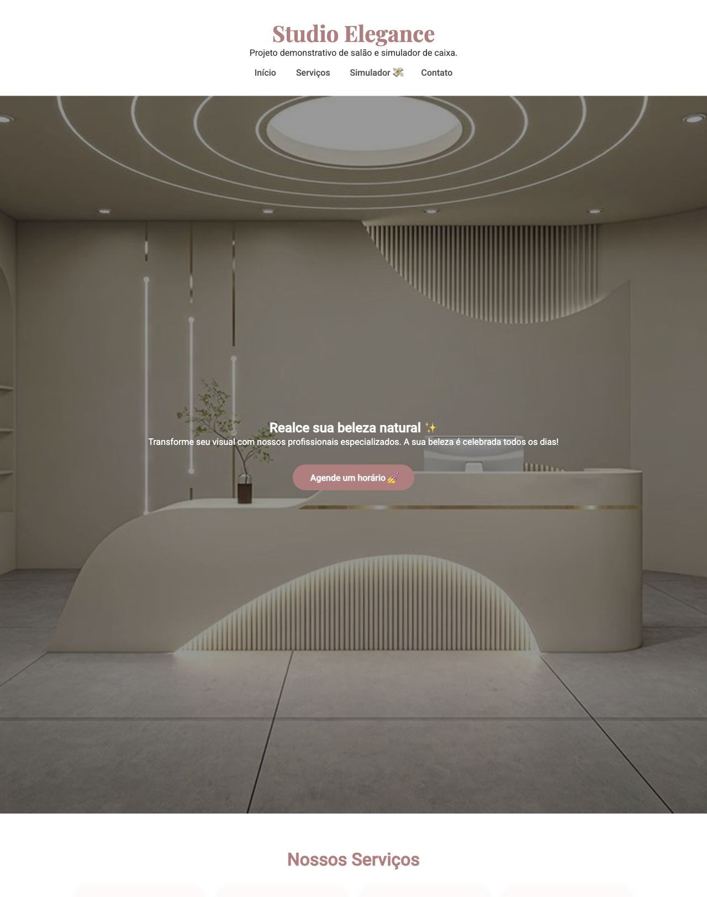

# Studio Elegance — Site e simulador de caixa

Página demonstrativa de salão com serviços e simulador de soma de itens, troco e limpeza da compra.

## Tecnologias

HTML, CSS e JavaScript, sem instalação de dependências para executar.

## Executar

Baixe os arquivos e abra `index.html` em um navegador moderno. Mantenha todos os arquivos na mesma pasta. Também é possível servir a pasta com um servidor HTTP local.

## Verificar os fluxos

1. Adicione dois serviços e confira a soma.
2. Informe um pagamento e calcule o troco.
3. Confira pagamento insuficiente, campo vazio e limpeza da compra.

## Escopo e limitações

Não há agendamento, transação ou cadastro real. Os itens ficam apenas na memória da página. Fontes são carregadas do Google Fonts e podem depender de acesso à internet.

## Origem

Projeto de estudo de [Abner Gabriel](https://github.com/Abnergabrel), separado da pasta [salao-de-beleza](https://github.com/Abnergabrel/JavaScript/tree/main/salao-de-beleza) para apresentação independente. Esta versão recebeu ajustes de funcionamento e documentação. O material original permanece preservado.
